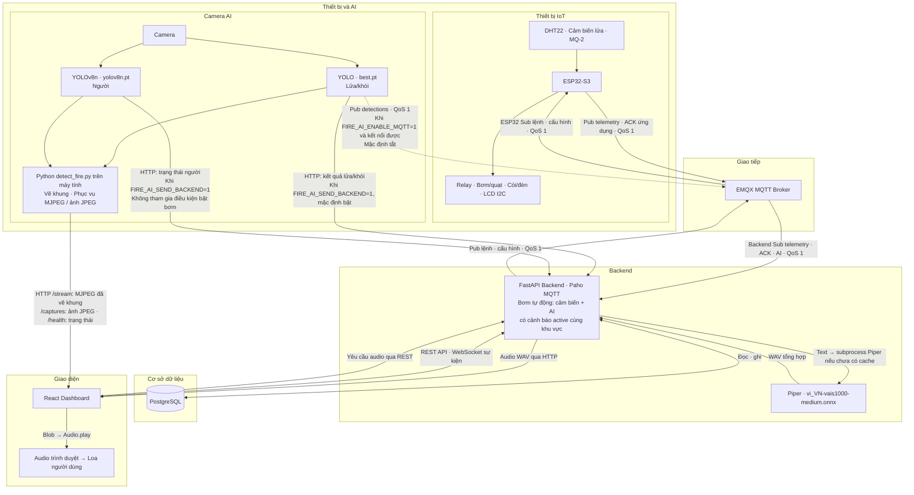

# Kiến trúc Fire-Watch

Đối chiếu source, cấu hình và kiểm tra đọc hệ thống ngày **15/10/2026 (Asia/Bangkok)**. Cập nhật theo yêu cầu chuyển model lửa/khói sang trọng số tự train `models/best.pt`: đã đổi mặc định trong `detect_fire.py` và cấu hình mẫu; giữ riêng model người `yolov8n.pt`. Sơ đồ dùng bố cục bốn tầng và màu sắc theo mẫu Mermaid người dùng cung cấp: Thiết bị/Camera AI → Giao tiếp → Backend/Database → Frontend. Những kết quả runtime dưới đây là snapshot lúc kiểm tra, không phải trạng thái giám sát trực tiếp.

## 1. Cách đọc và phạm vi xác minh

- **Đường liền:** kết nối có triển khai trong source, không đồng nghĩa mọi thiết bị đang online.
- **Đường nét đứt:** nhánh tùy chọn có code nhưng phải bật cấu hình; trạng thái chạy chưa xác nhận.
- Nhãn **mặc định**, **mẫu** và **runtime đã kiểm tra** được phân biệt trong bảng cấu hình bên dưới.
- Sơ đồ chỉ sử dụng thành phần chạy trên máy chủ/máy tính cục bộ, trình duyệt và ESP32. Ảnh camera và cache âm thanh là file cục bộ.
- Các đường MQTT mô tả chiều **dữ liệu được chuyển giao**, không phải chiều gói đăng ký SUBSCRIBE. `Sub` trên mũi tên broker → client nghĩa là client đã đăng ký nhận topic đó.

## 2. Sơ đồ phân tầng

Sơ đồ tổng quan dùng bố cục phân tầng theo mẫu người dùng cung cấp. Backend gộp FastAPI, Paho MQTT và logic xác nhận kép vào một node để dễ trình bày; các hàm, bảng và topic chi tiết được đối chiếu bên dưới. Hai model và video cùng thuộc tiến trình `detect_fire.py`; camera vật lý và thiết bị chấp hành nằm ngoài backend. `best.pt` và `yolov8n.pt` là lựa chọn mặc định, không phải xác nhận tiến trình camera hiện đang chạy. Piper chạy trong backend container; backend đọc/ghi cache WAV cục bộ trước khi trả audio cho trình duyệt.

HTTP AI và MQTT AI là hai nhánh cấu hình độc lập; không mặc định hoạt động đồng thời. Nét đứt chỉ nhánh MQTT tùy chọn, không phải video. Topic AI dùng `camera-01` mặc định; prefix và mã thiết bị/camera có thể được ghi đè bởi cấu hình. Lệnh thiết bị có retain=false; cấu hình thiết bị dùng cùng topic commands nhưng retain=true. ACK ESP32 là phản hồi ứng dụng, khác PUBACK của MQTT. Trạng thái relay chưa chứng minh hoạt động vật lý của bơm/quạt.

## 3. Cấu hình mặc định, mẫu và trạng thái đã kiểm tra

| Hạng mục | Mặc định trong code | Cấu hình mẫu / Compose | Runtime đã kiểm tra |
|---|---|---|---|
| Model lửa/khói tự train | `FIRE_AI_MODEL_PATH=models/best.pt` | `.env.example` cũng chọn `best.pt` | Đã nạp trực tiếp checkpoint bằng Ultralytics trong `.venv`: task `detect`, lớp `{0: 'Fire', 1: 'Smoke'}`; chưa xác minh tiến trình camera đang chạy với model này |
| Model người | `FIRE_AI_PERSON_MODEL_PATH=models/yolov8n.pt`; người bật mặc định | `.env.example` giống code | File tồn tại; chưa xác minh model đang nạp |
| `models/github_best.pt` | Không còn được chọn làm mặc định trong `detect_fire.py` | Không còn được chọn trong `.env.example`; `test_video.py` vẫn có để so sánh | File được giữ nguyên; không thuộc đường mặc định của ứng dụng |
| AI → HTTP | `FIRE_AI_SEND_BACKEND=1` | `.env.example`: `1` | Không tìm thấy `fire_ai/.env`; chưa xác minh biến môi trường của tiến trình AI |
| AI → MQTT | `FIRE_AI_ENABLE_MQTT=0` | `.env.example`: `0` | Chưa chứng minh AI đang publish; backend subscribe không chứng minh có publisher |
| Video | `FIRE_AI_ENABLE_STREAM=1`, cổng `8090`; webcam dò index | `.env.example` bật stream | Gọi `127.0.0.1:8090/health` bị từ chối kết nối lúc kiểm tra |
| Xác nhận qua khung hình | `FIRE_AI_CONFIRM_FRAMES=5`, clear `15` | `.env.example` đặt confirm `1`; runtime settings có thể ghi đè confirm/ngưỡng | Không khẳng định giá trị đang áp dụng trong tiến trình camera |
| Bơm xác nhận kép | `dual_confirmed_pump_enabled=True`, cooldown mặc định `30` giây | Compose bật `DUAL_CONFIRMED_PUMP_ENABLED=true` | Backend container trả về `True` |
| Piper | `piper_tts_enabled=False`, model path chưa đặt | Compose bật `true`, model `/data/voices/vi_VN-vais1000-medium.onnx` | Backend container: enabled `True`; executable `/usr/local/bin/piper`; file model tồn tại. Chưa gọi tổng hợp âm thanh |
| Database | PostgreSQL qua SQLAlchemy/psycopg | Compose: `postgres:16-alpine`; volume `infrastructure/postgres_data` | Sau migration `20261015_0009`, còn 10 bảng liệt kê trong mục 6; đã gỡ bảng media không sử dụng |
| MQTT | Prefix `fire`; backend 3 subscription QoS 1 | Compose trỏ backend đến service `emqx:1883`; firmware trỏ IP LAN cổng 1883 | EMQX liệt kê 3 subscription backend và 4 của MQTTX; chưa thấy ESP32 subscribe lúc kiểm tra |

Hai cờ AI HTTP và MQTT **độc lập**. Code gọi `send_to_backend()` rồi `publish_mqtt()`; mỗi hàm tự kiểm tra điều kiện. Không có cơ chế tự chuyển sang MQTT khi HTTP lỗi. Nếu người vận hành bật cả hai, cùng sự kiện có thể đi cả hai đường; không khẳng định có khử trùng sự kiện ở tầng nhập liệu. Theo mặc định/mẫu, HTTP bật và MQTT tắt.

## 4. Hai luồng AI và lưu trữ hình ảnh

**Lửa/khói:** `YOLO(MODEL_PATH)` → `model.predict()` → `read_fire_smoke_detections()`. Chỉ nhận nhãn `fire`, `smoke`, kiểm tra ngưỡng riêng; đầu ra gồm `label`, `confidence`, `bbox`. Vòng lặp xác nhận qua số khung hình, giới hạn tần suất gửi bằng `EVENT_COOLDOWN`; `save_event()` lưu JPEG vào `CAPTURE_FOLDER` (mặc định `captures`). `build_detection_payload()` bổ sung camera, khu vực, thời gian, tên model, đường dẫn ảnh; `video_path=None`. Khi xác nhận hết phát hiện, gửi `detections=[]` để cập nhật điều kiện AI.

**Người:** `YOLO(PERSON_MODEL_PATH)` → `person_model.predict(classes=[0])` → `read_person_detections()`. Đầu ra có nhãn `person`, confidence, bbox, số người và trạng thái; hình được vẽ lên cùng video, nhưng gửi backend bằng `/api/vision/person-state`, tách khỏi sự kiện lửa/khói. Backend lưu trạng thái người trong dictionary `latest_person_states` của tiến trình và broadcast `person_vision_state`; không có bảng lưu riêng trạng thái người trong luồng này.

Nhận diện người **không tạo cảnh báo cháy và không tham gia điều kiện bật bơm**. Tuy vậy, `CriticalFireOverlay` có kịch bản TTS nhắc có người khi đã có cảnh báo cháy; vì vậy không mô tả toàn bộ luồng người là chỉ vẽ lên video.

Đã nạp `models/best.pt` bằng `YOLO('models/best.pt')` trong môi trường `.venv` sẵn có: `task=detect`, `model.names={0: 'Fire', 1: 'Smoke'}`, kiểu model `DetectionModel`. `read_fire_smoke_detections()` chuẩn hóa tên lớp về chữ thường nên hai lớp này khớp `TARGET_CLASSES={'fire','smoke'}`. Không mở webcam, không tạo sự kiện, không gửi lệnh thiết bị trong kiểm tra nạp model. Chưa kiểm thử suy luận hoặc đánh giá chất lượng nhận diện. `train.py` dùng model nền `yolo26n.pt`, nhưng chưa đối chiếu đầy đủ nguồn gốc checkpoint; không tự gắn phiên bản kiến trúc cụ thể cho `best.pt` chỉ dựa trên script train.

Để dùng lựa chọn mới, khởi động lại `detect_fire.py` trong thư mục `fire_ai`. Nếu môi trường chạy đã đặt `FIRE_AI_MODEL_PATH`, biến đó vẫn ưu tiên hơn mặc định; cần đặt thành `models/best.pt` hoặc bỏ override cũ. Không tạo `.env` mới, không đổi model người, không đổi ngưỡng hoặc logic xác nhận kép trong lần cập nhật này.

Frontend tải video/ảnh **trực tiếp từ dịch vụ camera**, không qua broker MQTT, không truyền frame qua PostgreSQL. Database lưu metadata/đường dẫn ảnh trong `vision_detections`; ảnh JPEG nằm trên ổ đĩa máy chạy AI. `CaptureHistory.Photo` lấy tên file và tạo URL `/captures/{filename}`. `camera_test.py` chỉ mở webcam để xem thử, không phải chương trình gửi sự kiện AI. Backend cung cấp GET `/api/vision/capture-groups` để nhóm ảnh theo mã cảnh báo, chọn ảnh mới nhất và đếm toàn bộ ảnh khớp bộ lọc; GET `/api/vision/captures` tải chi tiết theo trang. Hai API này chỉ đọc bảng hiện có, không thay đổi cảnh báo hoặc lưu lại ảnh.

### Rà soát camera và phần cứng bên ngoài

| Thành phần ngoài backend | Đã thể hiện | Căn cứ / giới hạn |
|---|---|---|
| Webcam USB / camera laptop | Node `CAM`, đi riêng tới model lửa/khói và model người | `open_camera()` dò index và backend DSHOW/MSMF/ANY; chưa xác minh thiết bị camera vật lý nào đang gắn |
| Máy tính chạy AI ngoài Docker | Node `VIS` cùng hai node model | `DOCKER_RUN.md` chạy `python detect_fire.py` riêng; camera không phải service Compose |
| Cảm biến DHT22 | Node `SENS` → ESP32 | GPIO3; nhiệt độ/độ ẩm |
| Cảm biến lửa | Node `SENS` → ESP32 | GPIO6 / ADC1_CH5 |
| Cảm biến MQ-2 | Node `SENS` → ESP32 | GPIO5 / ADC1_CH4 |
| Relay bơm và bơm chữa cháy | ESP32 → nhóm `OUT` | GPIO16; trạng thái relay có trong telemetry/ACK, chưa xác minh đấu nối/cấp nước thực tế |
| Relay quạt và quạt hút | ESP32 → nhóm `OUT` | GPIO15; chưa kiểm tra hoạt động vật lý |
| Còi / đèn | ESP32 → `OUT` | GPIO7 / GPIO2 |
| LCD I2C | ESP32 → `OUT` | SDA GPIO8, SCL GPIO9; địa chỉ cấu hình `0x27` |
| Loa thiết bị người dùng | Node `AUDIO` | Audio phát từ trình duyệt; không có bằng chứng loa TTS nối ESP32 |

Nhóm bơm/quạt mô tả thiết kế điều khiển có trong firmware, không phải xác nhận phần cứng đã lắp hoặc đang hoạt động. Không thêm camera IP/RTSP, đầu ghi hay thiết bị ngoài chưa có kết nối thực trong source.

## 5. MQTT, xác nhận cháy và điều khiển

| Publisher | Topic publish | Subscriber và bộ lọc | QoS publish / subscribe | Retain |
|---|---|---|---|---|
| ESP32 | `fire/devices/esp32-s3-01/telemetry` | Backend: `fire/devices/+/telemetry` | `1 / 1` | `false` |
| ESP32 | `fire/devices/esp32-s3-01/commands/ack` | Backend: `fire/devices/+/commands/ack` | `1 / 1` | `false` |
| Backend, lệnh thiết bị | `fire/devices/{device_code}/commands` | ESP32 hiện cấu hình: `fire/devices/esp32-s3-01/commands` | `1 / 1` | `false` |
| Backend, cấu hình runtime | `fire/devices/esp32-s3-01/commands` | Cùng subscription nhận lệnh của ESP32 | `1 / 1` | `true` |
| AI, chỉ khi bật MQTT và kết nối thành công | `fire/ai/{CAMERA_CODE}/detections`, mặc định `camera-01` | Backend: `fire/ai/+/detections` | `1 / 1` | Mặc định `false` của `paho.publish()` |

Backend có **3 bộ lọc subscription**, firmware có **1 subscription trên mỗi ESP32**. Không có subscription MQTT trong chương trình AI. Frontend không nối MQTT trực tiếp. MQTTX là công cụ quan sát ngoài ứng dụng; tại lúc kiểm tra có 4 subscription QoS 0, gồm 3 bộ lọc dữ liệu của backend và topic commands của `esp32-s3-01`. MQTTX không nằm trong điều kiện điều khiển.

Luồng tự động được triển khai như sau:

1. ESP32 đọc Flame/DHT22/MQ-2, xử lý ngưỡng cục bộ và publish telemetry. Giá trị nhiệt độ/độ ẩm lỗi được gửi `null`; backend lưu nullable, không thay bằng `0`. MQ-2 là ADC thô, không tự diễn giải thành ppm.
2. Backend `record_telemetry()` tạo/cập nhật cảnh báo cảm biến; `record_vision_detection()` tạo/cập nhật cảnh báo AI khi có nhãn lửa/khói.
3. `send_pump_on_if_dual_confirmed()` yêu cầu cả cảnh báo `sensor` và `ai` **cùng `area_id`**, status thuộc `open`/`acknowledged`, `condition_cleared_at IS NULL`. Hàm này không kiểm tra cửa sổ thời gian mới nhất của hai dữ liệu; không ghi vào sơ đồ điều kiện thời gian mà code chưa có. Hàm còn kiểm tra lệnh bật bơm gần đây để hạn chế gửi lặp.
4. Backend tạo `Command`, publish JSON chứa `command_uuid`, `target=pump`, `action=on`; nhánh tự động còn có `source`, `alert_id`, `dual_confirmed`. `pump:on` là cách gọi tắt; payload thực tế là JSON, không phải chuỗi `pump:on`.
5. Firmware chỉ chấp nhận bật bơm khi trạng thái cháy cục bộ là `STATE_FIRE`; có thể phản hồi `status=failed` nếu bị chặn. Cảm biến lửa đơn lẻ kích hoạt còi/đèn, không tự gọi bật bơm trong `enter_fire_state()`. MQ-2 điều khiển quạt theo logic riêng. Firmware cũng có xử lý tắt bơm sau khi hết cháy.
6. ESP32 publish ACK ứng dụng với cùng `command_uuid`, `status` (`acknowledged` hoặc `failed`), message và trạng thái đầu ra. Backend nhận, lưu `ack_payload`, thời điểm ACK và broadcast `command_ack`.

**Giới hạn hiện có cần đọc đúng:** `acknowledge_command()` đặt `Command.status="acknowledged"` khi tìm thấy UUID, kể cả khi payload ESP32 có `status="failed"`. Do đó ACK đã về không đồng nghĩa thao tác thành công; cần đọc cả `ack_payload.status`, message và trạng thái đầu ra. Không sửa logic này trong nhiệm vụ tài liệu.

Lệnh thủ công qua `POST /api/commands` là đường riêng, không gọi hàm xác nhận kép; firmware vẫn áp dụng chặn bật bơm theo trạng thái cháy cục bộ. Cấu hình qua `PUT /api/settings` dùng cùng topic commands nhưng `target=config`, `action=set`, retained; firmware lưu runtime config vào NVS. Không mô tả mọi lệnh điều khiển đều phải đi qua xác nhận kép.

## 6. Backend, database, frontend và Piper

Backend là FastAPI, chạy Uvicorn; startup khởi động Paho MQTT client. SQLAlchemy/psycopg kết nối PostgreSQL. Dockerfile chạy `alembic upgrade head` trước Uvicorn. PostgreSQL nằm trong Compose cục bộ: cổng nội bộ `5432`, cổng host `15432`, lưu volume trên máy.

Các bảng đã được xác nhận bằng cả ORM và introspection database đang chạy:

| Model | Bảng | Vai trò / quan hệ chính |
|---|---|---|
| `Area` | `areas` | Khu vực |
| `Device` | `devices` | Thiết bị/camera thuộc khu vực |
| `User` | `users` | Người dùng |
| `Telemetry` | `telemetry` | Số đo, trạng thái; liên kết thiết bị |
| `Alert` | `alerts` | Cảnh báo; khu vực, thiết bị nguồn, người tiếp nhận/đóng |
| `VisionDetection` | `vision_detections` | Kết quả AI, metadata/đường dẫn; camera, cảnh báo |
| `Command` | `commands` | Lệnh, UUID, trạng thái, ACK; thiết bị, người yêu cầu |
| `AuditLog` | `audit_logs` | Nhật ký thao tác, liên kết người thực hiện |
| `RuntimeSetting` | `runtime_settings` | Cấu hình runtime |
| Alembic | `alembic_version` | Phiên bản migration; không phải bảng nghiệp vụ ORM |

Frontend sử dụng React 19, TypeScript, Vite, React Router, Tailwind; Compose build file tĩnh rồi phục vụ bằng Nginx ở host `3000`. Khi phát triển, script Vite cũng dùng cổng `3000`. `ApiFireWatchService` dùng `fetch` gọi REST: khu vực, thiết bị, cảm biến mới nhất/lịch sử, cảnh báo, lệnh, nhật ký, cấu hình. WebSocket `/ws` nhận sự kiện; subscription telemetry còn polling REST mỗi `1000 ms` song song. Không mô tả toàn bộ giao diện chỉ dùng WebSocket. Provider polling `/health` của camera để lấy trạng thái camera/người; backend cũng có API trạng thái người và broadcast riêng.

**Piper chạy trong backend container**, được cài trong Dockerfile, dùng model giọng Việt từ volume `./data/voices:/data/voices:ro`. Có cả `vi_VN-vais1000-medium.onnx` và file cấu hình `.onnx.json` trong repo; cấu hình giọng xác nhận `vi`, sample rate `22050`.

Đường audio được triển khai: `CriticalFireOverlay` hoặc luồng cảnh báo MQ-2 trong `FireWatchProvider` → HTTP `POST /api/tts/piper` với text → FastAPI `synthesize_piper()` đọc WAV cache hoặc gọi executable `piper` bằng `subprocess.run()` → trả response `audio/wav` → browser đọc `Blob`, tạo object URL → `new Audio(...).play()` → loa thiết bị người dùng. Cache ở `/data/tts_cache` được volume backend lưu trên máy. Đường âm thanh không đi MQTT/ESP32. Trạng thái **đã bật và đủ file/executable** được kiểm chứng; chưa xác nhận tổng hợp thành công hoặc trình duyệt cho phép phát tiếng trong phiên hiện tại.

## 7. Chú giải

| Thuật ngữ | Ý nghĩa trong project |
|---|---|
| Pub / Publish | Client gửi message vào topic broker |
| Sub / Subscribe | Client đăng ký bộ lọc topic để nhận message broker chuyển tới |
| MQTT | Giao thức trao đổi message qua EMQX, cổng TCP `1883` theo cấu hình |
| QoS 1 / PUBACK | MQTT giao ít nhất một lần; có thể trùng tin. PUBACK là xác nhận giao thức giữa hai đầu của một chặng, không chứng minh relay/bơm đã thực hiện |
| ACK ứng dụng | JSON do ESP32 publish trên `.../commands/ack`, đối chiếu `command_uuid`; có status thành công hoặc thất bại |
| ACK cảnh báo | `/api/alerts/{id}/ack`: thao tác người dùng tiếp nhận cảnh báo; khác ACK lệnh ESP32 và PUBACK |
| `+` | Wildcard một cấp topic; backend dùng cho mã thiết bị/camera |
| `{device_code}`, `{CAMERA_CODE}` | Biến được thay bằng giá trị cấu hình, không phải wildcard MQTT |
| HTTP / REST | Request/response JSON cho dữ liệu, cấu hình, lệnh và sự kiện; audio trả WAV |
| WebSocket | Kết nối realtime `/ws`; backend broadcast event JSON |
| MJPEG | Luồng JPEG liên tiếp qua HTTP `/stream`; frontend hiển thị bằng thẻ `img` |
| Retain | Broker giữ message cấu hình cuối trên topic commands; lệnh thiết bị thông thường không retained |

## 8. Bảng dẫn chứng source và kiểm chứng

Các đường dẫn dưới đây tương đối với tài liệu này. Tên hàm/route giúp tra cứu khi số dòng thay đổi.

| Thành phần / luồng | File bằng chứng | Hàm, route, topic hoặc cấu hình |
|---|---|---|
| Phần cứng, khu vực, MQTT ESP32 | [config.h](../esp32-firmware/main/config.h) | GPIO cảm biến, relay, LED, buzzer, LCD; `MQTT_BROKER_URI`, prefix `fire`, device `esp32-s3-01`, area `default` |
| Cảm biến → telemetry | [main.c](../esp32-firmware/main/main.c) | `mqtt_publish_telemetry()`, `mqtt_publish_json()`; topic `/telemetry`, QoS `1`, retain `0`; DHT lỗi → null |
| Nhận lệnh / ACK / NVS | [main.c](../esp32-firmware/main/main.c) | `MQTT_EVENT_CONNECTED`, `esp_mqtt_client_subscribe()`, `MQTT_EVENT_DATA`, `handle_mqtt_command()`, `mqtt_publish_command_ack()`, `save_runtime_config()` |
| Cháy cục bộ / thiết bị đầu ra | [main.c](../esp32-firmware/main/main.c) | `enter_fire_state()`, `leave_fire_state()`, `update_fire_detection()`, `update_fire_outputs()`, chặn pump on nếu không `STATE_FIRE` |
| Camera và model lửa/khói | [detect_fire.py](../fire_ai/detect_fire.py) | `open_camera()`, `YOLO(MODEL_PATH)`, `read_fire_smoke_detections()`, `TARGET_CLASSES`, vòng lặp confirm/clear |
| File trọng số hiện có | [best.pt](../fire_ai/models/best.pt), [yolov8n.pt](../fire_ai/models/yolov8n.pt), [github_best.pt](../fire_ai/models/github_best.pt) | Mặc định: `best.pt` cho lửa/khói, `yolov8n.pt` cho người; `github_best.pt` giữ lại để so sánh, không được chọn mặc định |
| Model người / trạng thái | [detect_fire.py](../fire_ai/detect_fire.py) | `load_person_model()`, `read_person_detections()`, `PERSON_CLASS_ID=0`, `build_person_state_payload()`, `publish_person_state_to_backend()` |
| Video / ảnh cục bộ | [detect_fire.py](../fire_ai/detect_fire.py) | `set_stream_frame()`, `StreamHandler.do_GET()`, `start_stream_server()`, `save_event()`; `/stream`, `/health`, `/captures/...` |
| AI HTTP / MQTT có điều kiện | [detect_fire.py](../fire_ai/detect_fire.py), [.env.example](../fire_ai/.env.example) | `SEND_TO_BACKEND`, `ENABLE_MQTT`, `send_to_backend()`, `connect_mqtt()`, `publish_mqtt()`; `/api/vision/detections`, `fire/ai/{CAMERA_CODE}/detections` |
| AI lấy ngưỡng backend | [detect_fire.py](../fire_ai/detect_fire.py) | `refresh_runtime_settings()`: GET `/api/settings`, cập nhật ngưỡng và số frame confirm |
| Camera test, train và so sánh | [camera_test.py](../fire_ai/camera_test.py), [train.py](../fire_ai/train.py), [README](../fire_ai/README.md), [test_video.py](../fire_ai/test_video.py) | Camera test không gửi sự kiện; script train dùng nền `yolo26n.pt`; script video so sánh các trọng số; checkpoint `best.pt` đã kiểm tra nạp riêng |
| Backend framework / vòng đời | [main.py](../backend/app/main.py), [Dockerfile](../backend/Dockerfile), [requirements.txt](../backend/requirements.txt) | FastAPI, lifespan MQTT, Uvicorn, Alembic, Paho, SQLAlchemy, psycopg, cài Piper |
| MQTT backend | [client.py](../backend/app/mqtt/client.py) | `_on_connect()` 3 Sub QoS 1; `publish_command()`, `publish_device_config()`, `_route_message()`, `_handle_telemetry()`, `_handle_vision()`, `_handle_command_ack()` |
| Nhận AI / trạng thái người | [vision.py](../backend/app/api/vision.py), [schemas/vision.py](../backend/app/schemas/vision.py) | GET/POST `/api/vision/detections`; POST `/api/vision/person-state`; GET `/api/vision/person-state/{camera_id}`; dictionary RAM và broadcast |
| Cảnh báo và lưu ACK | [fire_monitoring.py](../backend/app/services/fire_monitoring.py) | `record_telemetry()`, `record_vision_detection()`, `acknowledge_command()`; phân biệt trạng thái Command và ACK payload |
| Xác nhận kép | [dual_confirmation.py](../backend/app/services/dual_confirmation.py) | `_has_active_alert()`, `_has_recent_pump_command()`, `send_pump_on_if_dual_confirmed()` |
| REST lệnh thủ công | [commands.py](../backend/app/api/commands.py) | GET/POST `/api/commands`, JSON `command_uuid/target/action`, broadcast `command_sent` |
| REST giao diện / cấu hình | [dashboard.py](../backend/app/api/dashboard.py), [alerts.py](../backend/app/api/alerts.py) | `/api/areas`, `/api/devices`, `/api/sensors/latest`, `/api/sensors/history`, `/api/logs`, GET/PUT `/api/settings`, `/api/alerts` và ACK cảnh báo |
| Realtime | [websocket.py](../backend/app/api/websocket.py), [manager.py](../backend/app/websocket/manager.py) | `/ws`, `broadcast()`; MQTT client và REST handlers phát event |
| Kết nối database / bảng | [connection.py](../backend/app/database/connection.py), [models](../backend/app/models/__init__.py) | `create_engine()`, `SessionLocal`, các ORM `__tablename__`; introspection runtime đối chiếu danh sách mục 6 |
| Triển khai cục bộ | [docker-compose.yml](../docker-compose.yml) | EMQX, PostgreSQL 16, backend, frontend; port mapping, volume, cấu hình Piper và dual-confirm |
| Frontend / trang chính | [package.json](../fe/package.json), [navigation.ts](../fe/src/features/firewatch/navigation.ts), [Dockerfile](../fe/Dockerfile) | React/Vite/TypeScript/Tailwind, các trang, build tĩnh phục vụ qua Nginx |
| REST / WS / polling frontend | [apiService.ts](../fe/src/features/firewatch/services/apiService.ts), [services/index.ts](../fe/src/features/firewatch/services/index.ts) | `ApiFireWatchService`, `fetch`, `subscribeTelemetry()`, WebSocket `/ws`, polling 1000 ms |
| Hiển thị camera / ảnh / health | [CameraPlayer.tsx](../fe/src/features/firewatch/components/camera/CameraPlayer.tsx), [CaptureHistory.tsx](../fe/src/features/firewatch/components/camera/CaptureHistory.tsx), [capture_history.py](../backend/app/services/capture_history.py), [FireWatchProvider.tsx](../fe/src/features/firewatch/context/FireWatchProvider.tsx) | `img src=streamUrl`, `Photo`, GET `/api/vision/capture-groups`, GET `/api/vision/captures`, provider gọi camera `/health` |
| Piper server / giọng Việt | [tts.py](../backend/app/api/tts.py), [config.py](../backend/app/core/config.py), [voice config](../data/voices/vi_VN-vais1000-medium.onnx.json) | POST `/api/tts/piper`, `synthesize_piper()`, `subprocess.run()`, `audio/wav`, cache; enabled mặc định false, Compose true |
| Audio ở browser | [CriticalFireOverlay.tsx](../fe/src/features/firewatch/layouts/CriticalFireOverlay.tsx), [FireWatchProvider.tsx](../fe/src/features/firewatch/context/FireWatchProvider.tsx) | Fetch Piper, Blob, `URL.createObjectURL()`, `new Audio().play()`; kịch bản cháy/người trong cháy và MQ-2 |

Kiểm tra runtime chỉ đọc: `emqx ctl subscriptions list`; Python trong backend đọc `get_settings()`, `shutil.which()`, kiểm tra file model và SQLAlchemy `inspect(engine).get_table_names()`; HTTP GET health camera và trạng thái người. Kiểm tra bổ sung: nạp `best.pt` bằng Ultralytics trong `.venv` sẵn có để đọc task/classes. Không gửi lệnh thiết bị, không phát dữ liệu giả, không gọi tổng hợp TTS tạo cache.

## 9. Chưa xác minh / chưa triển khai

1. Mẫu Mermaid được dùng làm tham chiếu bố cục và màu sắc. Không đưa simulator, Mosquitto hoặc ứng dụng Flutter trong mẫu vào kiến trúc vì chưa có bằng chứng chúng thuộc hệ thống hiện tại.
2. Dịch vụ camera cổng 8090 không phản hồi tại lúc kiểm tra; GET trạng thái người `camera-01` ở backend trả `404`. Không kết luận camera/model/HTTP AI/MQTT AI đang hoạt động. Không tìm thấy `fire_ai/.env`; biến môi trường ngoài file có thể ghi đè mặc định.
3. Mặc định và cấu hình mẫu đã chuyển sang `best.pt`, checkpoint nạp được với hai lớp Fire/Smoke. Chưa xác minh tiến trình camera đã khởi động lại với cấu hình mới hoặc có override môi trường; chưa đo độ chính xác/suy luận trên camera thực và chưa xác nhận đầy đủ nguồn gốc checkpoint từ lần train cụ thể.
4. Chưa thấy subscription ESP32 trong snapshot EMQX. Chưa kiểm chứng end-to-end cảm biến → xác nhận kép → lệnh → ACK → đầu ra vật lý. Trạng thái relay trong message không chứng minh bơm có nước hoặc đủ áp lực.
5. Piper đã bật trong container và đủ executable/model; chưa thử tổng hợp mới, chưa xác minh file audio phát thành công trên trình duyệt hoặc quyền autoplay. Không ghi “TTS đang phát hoạt động” chỉ dựa trên cấu hình.
6. Bảng media không sử dụng cùng ORM/schema/type liên quan đã được gỡ bằng migration [20261015_0009](../backend/alembic/versions/20261015_0009_remove_alert_media.py). Migration tạo bảng cũ vẫn được giữ trong lịch sử Alembic. Ảnh capture tiếp tục lưu JPEG cục bộ và đường dẫn tại `vision_detections.snapshot_path`; không có luồng ghi video sự kiện được xác minh. Cột `vision_detections.video_path` nullable vẫn giữ để tương thích dữ liệu/API hiện tại, không đồng nghĩa đang ghi video.
7. Thành phần camera có prop `rtspUrl`, nhưng chương trình AI hiện mở webcam theo index và frontend dùng MJPEG. Không coi RTSP/IP camera là kết nối đã triển khai.
8. Hàm xác nhận kép kiểm tra cảnh báo active cùng khu vực, chưa kiểm tra độ mới dữ liệu theo cửa sổ thời gian. Lệnh thủ công có đường riêng. ACK ứng dụng phải đọc status thực tế do giới hạn lưu trạng thái đã nêu; không bổ sung cơ chế chưa có vào sơ đồ.
9. Không tìm thấy executable `mmdc` hoặc Mermaid renderer trong dependencies frontend hiện có. Giữ sơ đồ Mermaid trong Markdown, không cài package và không xuất SVG chưa được render/kiểm tra.
